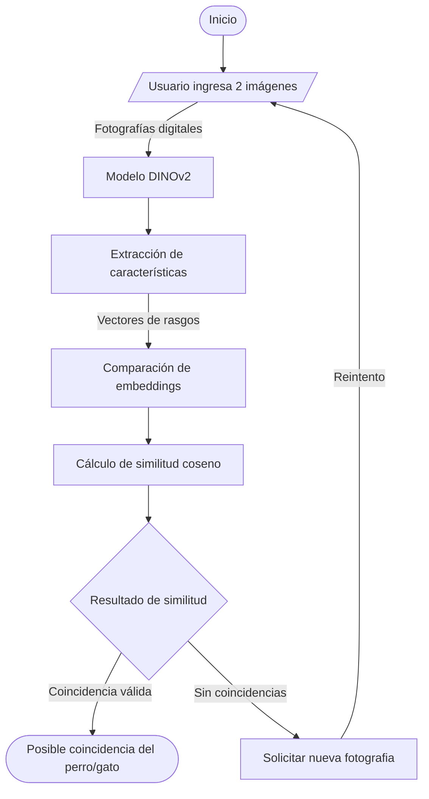

# in1050-a4-mascotas

# Nombre del proyecto
Este proyecto busca ayudar a las personas que han perdido a sus perros o que han encontrado uno y desean saber si podría pertenecer a alguien. Para ello, se desarrolla un sistema basado en inteligencia artificial capaz de comparar dos fotografías de perros y analizar qué tan similares son visualmente. El sistema utiliza un modelo especializado en identificación individual de animales para extraer características de las imágenes y calcular un valor de similitud. De esta manera, se busca ofrecer una herramienta tecnológica que facilite la búsqueda y recuperación de mascotas, apoyando a sus dueños y a las personas que participan en el rescate y cuidado de animales.

## Equipo
|Nombre completo|Rol de equipo|
|---|---|
|Pablo Israel Avalos Moreno|Encargado del README principal del equipo|
|Hector Ulises Serrano Ramos|Encargado de asignación y control del modelo|
|Jessica Abigail Tovar Solis|Encargada de la parte creativa y visual|

## Problemática
La pérdida de mascotas es una situación que afecta a muchas familias y encontrar a un perro puede resultar complicado cuando no se cuenta con información suficiente para identificarlo. En ocasiones, las personas publican fotografías de perros encontrados o buscan a sus mascotas mediante redes sociales, pero comparar visualmente las imágenes puede ser difícil, especialmente cuando existen diferencias de iluminación, posición, distancia o calidad fotográfica. Por esta razón, nuestro proyecto propone utilizar inteligencia artificial para analizar las características visuales de los perros y determinar si dos fotografías podrían corresponder al mismo animal.

## Caso de uso
El usuario principal es una persona que ha perdido a su perro o que ha encontrado uno y desea comprobar si podría tratarse de la misma mascota.

El funcionamiento contempla los siguientes elementos:

Entrada: el usuario proporciona dos fotografías de perros que desea comparar.

Procesamiento: el sistema analiza ambas imágenes mediante un modelo especializado en identificación individual de animales.

Resultado: se obtiene un valor de similitud que permite conocer qué tan parecidas son las características visuales de ambos perros.

Interpretación: con base en el resultado, el sistema ofrece una orientación sobre la posibilidad de que las fotografías correspondan al mismo perro.

El resultado funciona como una referencia para apoyar la búsqueda, no como una confirmación definitiva de identidad.

## Modelo
|Dato|Respuesta|
|---|---|
|Identificador|[AvitoTech/DINO-v2-small-for-animal-identification](https://www.google.com/url?q=https%3A%2F%2Fhuggingface.co%2FAvitoTech%2FSigLIP2-Base-for-animal-identification)|
|Tarea (pipeline tag)|`image-feature-extraction (Extracción de Embeddings para Re identificación)`|
|Número de parámetros| 22,000,000|
|Licencia|Apache 2.0 |
|Limitación o sesgo declarado| Disminución en la precisión de identificación cuando las fotografías presentan iluminación deficiente, ángulos muy inclinados o cuando el rostro/cuerpo de la mascota se encuentra parcialmente ocluido.|

## Como funciona

## Viabilidad de hardware

Memoria mínima=N×2 bytes≈ ? GB

$$
\text{Memoria mínima} = N \times 4\ \text{bytes} \approx \ ?\ \text{GB}
$$

$$
\text{Memoria mínima} = 22,100,000 \times 4\ \text{bytes} \approx 88,400,000\ \text{bytes}
$$

- **VRAM disponible en Colab:** 14  GB (GPU-T4)
- **Dónde se ejecuta:** Colab on GPU
- **Por qué:** Se ejecutará en Google Colab con GPU. El modelo requiere únicamente ~88.4 MB, lo que representa menos del 5% de la VRAM asignada por Colab. Esto garantiza una inferencia rápida y local sin exceder los recursos del entorno gratuito ni depender de cuotas de una API externa.

## Riesgo ético

- **Riesgo:** Posible error en la comparación de imágenes, y a futuro, pueden existir riesgos mayores debido al uso de datos personales. 
- **Mitigación:** Para nuestro riesgo actual (comparación falsa) podemos definir de manera más precisa los parámetros de las comparaciones. 
