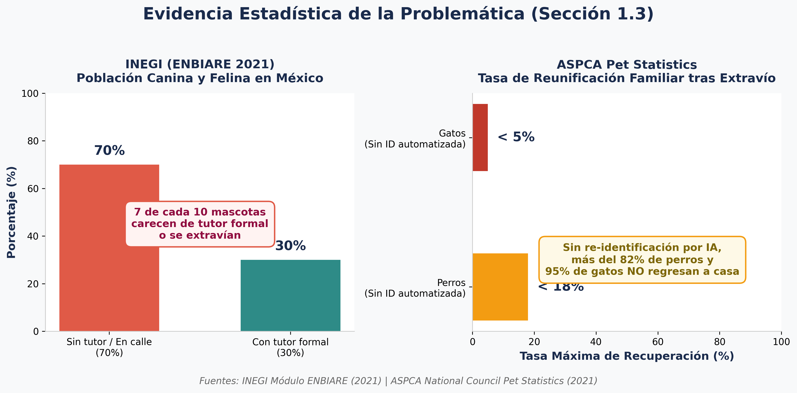

# Documento de Investigación: Comparador Visual para Identificación de Perros y Gatos mediante Extracción de Embeddings

## 1. El problema
### **Definición y contexto de la problemática**

El extravío y la identificación imprecisa de perros y gatos constituye un desafío significativo de bienestar animal y gestión en albergues y clínicas veterinarias. En entornos urbanos y rurales, miles de animales de compañía se pierden anualmente o son ingresados a refugios sin un registro fenotípico claro. La determinación precisa de similitudes físicas no es únicamente una cuestión de conocimiento para sus tutores; tiene implicaciones directas en la re-identificación ágil de animales perdidos para su reunificación familiar, y en el caso de la identificación de razas, ayuda en el diagnóstico médico preventivo y en procesos de adopción.

Actualmente, la identificación visual manual por parte de tutores o personal de albergues depende de apreciaciones subjetivas. Es vital aclarar que las características de una mascota pueden ser difíciles de describir con palabras. La falta de herramientas automatizadas para comparar visualmente a un animal extraviado contra bases de datos fotográficas de animales encontrados (o catálogos de razas de referencia) dificulta el rastreo y limita la efectividad de las búsquedas.

### **A quién afecta**

1. **Tutores de mascotas y familias:** Quienes enfrentan incertidumbre tras la desaparición de sus animales de compañía y buscan cotejar reportes visuales de animales encontrados.
2. **Albergues y asociaciones protectoras:** Organizaciones con recursos operativos limitados que reciben diariamente animales sin identificación. Requieren cruzar fotos de los ingresos con catálogos de mascotas reportadas como perdidas o catálogos de razas para  registro.
3.  **Médicos veterinarios y autoridades:** Profesionales que necesitan referencias visuales sólidas para determinar predisposiciones fenotípicas o gestionar censos de fauna doméstica.

### **Magnitud del problema y evidencia estadística**

El impacto del extravío y la falta de identificación de mascotas alcanza proporciones nacionales relevantes:
- **Estadísticas de fauna sin hogar:** Se estima que 7 de cada 10 perros y gatos carecen de un tutor formal o se encuentran en situación de calle en algún momento de su vida en México, convirtiendo la gestión poblacional canina y felina en un tema prioritario de salud pública [INEGI, 2021](https://www.inegi.org.mx/programas/enbiare/2021/).
- **Tasa de recuperación y fallos de identificación:** Aproximadamente del 15% al 20% de las familias enfrentan el extravío de una mascota en un periodo de 5 años. De aquellas sin microchip, menos del 18% de los perros y menos del 5% de los gatos logran regresar a su hogar. Gran parte de esta baja tasa se debe a la dificultad de clasificar e identificar visualmente a la mascota encontrada contra los reportes de pérdida [ASPCA, 2021](https://www.aspca.org/helping-shelters-people-pets/us-animal-shelter-statistics).

## 2. Cómo se resuelve hoy
Para hacer frente a la identificación de animales de compañía, se emplean tradicionalmente diversos métodos, pero la mayoría presenta barreras operativas para la comparación visual ágil.

| Solución / Alternativa | Lo que ofrece| Limitaciones principales |
| --------- | --------- | --------- |
| 1. Identificación por Microchip | Inserción subdérmica de un transpondedor con código numérico único e inalterable vinculado a una base de datos.  | Requiere un lector electrónico específico (solo en clínicas); no ofrece identificación visual remota por foto; costo elevado; base de datos frecuentemente desactualizada.   |
| 2. Placas físicas y código QR en collar | Medios visibles fijados al collar que contienen números telefónicos o un enlace QR hacia un perfil digital.  | Susceptibles a pérdida o desprendimiento; inútiles si la mascota escapa sin collar; requieren manipulación a muy corta distancia.   |
| 3. Catalogación manual por fenotipo | Evaluación visual realizada por humanos comparando el aspecto con guías estandarizadas o reportes impresos.  | Altamente subjetiva y dependiente de la memoria y experiencia humana; consume mucho tiempo; no escalable para revisar miles de fotos de perros perdidos/encontrados.   |

## 3. Por qué con IA y por qué este modelo
### **Ventajas del enfoque comparativo con Inteligencia Artificial**

La Visión por Computadora transforma la identificación al sustituir la comparación humana manual por la extracción automatizada de características sutiles **(embeddings)**. Un modelo de IA no "adivina" una raza de la nada, sino que analiza patrones complejos de texturas, morfología facial y proporciones en una fotografía, y genera un vector numérico. Este sistema permite medir matemáticamente la distancia vectorial (similitud) entre las imagenes que sube el usuario.

### **Selección del modelo y viabilidad de hardware**

Se seleccionó el modelo abierto AvitoTech/DINO-v2-small-for-animal-identification [AvitoTech, 2024](https://huggingface.co/AvitoTech/DINO-v2-small-for-animal-identification), basado en la arquitectura de Vision Transformers (Meta AI Research, 2023). Este modelo está especializado puramente en *image-feature-extraction* enfocado en perros y gatos.

El modelo cuenta con 22.1 millones de parámetros (tamaño Small). La memoria mínima en VRAM para alojar los pesos en precisión FLOAT32 se calcula como:

$$
Memoria = 22,100,000 parámetros × 4 bytes/parámetro = 88,400,000 bytes ≈ 88.4 MB
$$

Este bajo consumo garantiza una inferencia ultrarrápida y local (Google Colab con GPU T4 ofrece 15 GB), sin necesidad de costosas APIs externas.

### **Comparación con otro modelo**

| Criterio | Modelo Elegido: AvitoTech/DINO-v2-small | Modelo Alternativo: google/vit-base-patch16-224 |
| --------- | --------- | --------- |
| Tarea | Extracción de características (Embeddings comparativos).  | Clasificación directa de imágenes generales.   |
| Parametros | 22.1 Millones (Liviano)  | 86.6 Millones (Mediano)   |
| Ventajas | Inferencia rápida; genera vectores optimizados para comparar similitud exacta entre dos perros/gatos. | Alta precisión en clases generales (ImageNet). Amplio soporte.   |
| Desventajas | Sensible a oclusiones severas o imágenes muy oscuras. Requiere base de datos de imágenes de referencia.  | Devuelve etiquetas estáticas, no permite comparar si el "Perro A" es el mismo individuo que el "Perro B".   |

## 4. Usuarios y requisitos
### **Perfiles de usuario**

- **Usuario General / Tutor de Mascota:** Sube una foto clara de un perro/gato encontrado para cotejarla contra el catálogo de mascotas perdidas, o contra el catálogo de razas para orientarse sobre su fenotipo.
- **Rescatista / Administrador de Albergue:** Digitaliza a los animales rescatados subiendo sus fotos para que formen parte del catálogo de referencia, facilitando futuras comparaciones.

### **Lista de requisitos del sistema**

**Requisitos Funcionales (RF):**

- **RF-01 (Carga):** El sistema debe permitir cargar fotografías (.jpg, .png) de perros y gatos.
- **RF-02 (Embeddings):** El sistema procesará la imagen con DINO-v2 para generar un vector matemático.
- **RF-03 (Comparación Vectorial):** El sistema calculará la distancia coseno entre el vector de la foto ingresada y los vectores de las fotografías del catálogo de referencia pre-cargado.
- **RF-04 (Resultados):** Se mostrará la imagen de referencia con mayor similitud visual y su porcentaje de coincidencia.

**Requisitos No Funcionales (RNF)**:
- **RNF-01 (Eficiencia):** El consumo del modelo base no superará los 100 MB de VRAM en inferencia.
- **RNF-02 (Respuesta):** La comparación tomará menos de 2 segundos.

## 5. Impacto ético (Alineación Magnífica Humanitas)
Bajo los principios éticos de diseño tecnológico [León XIV, 2026](https://www.vatican.va/content/leo-xiv/es/encyclicals/documents/20260515-magnifica-humanitas.html), se contemplan los siguientes aspectos:

- **Privacidad de los datos:** Las fotografías proporcionadas se procesan efímeramente. No se conservan rostros humanos de fondo ni metadatos GPS tras la extracción del vector.  
- **Sesgos del modelo y a quién perjudica:** Las IA visuales suelen estar entrenadas mayoritariamente con perros y gatos de razas puras bien iluminados. Al comparar mascotas mestizas (criollos) o en malas condiciones de luz, la precisión baja.
Este sesgo afectaría a animales en albergues o situación de calle, ya que una clasificación imprecisa dificultaría el rastreo de mascotas extraviadas. Por ello el sistema informará claramente que es una **"similitud calculada"**, no una verdad absoluta, para no difundir información falsa.  
- **Responsabilidad humana:** La IA actúa como filtro de apoyo. La confirmación visual final para entregar una mascota a quien dice ser su dueño recae siempre en un operador humano.
- **Costo energético de la infraestructura:** 
El uso del modelo liviano `AvitoTech/DINO-v2-small-for-animal-identification` (22.1 millones de parámetros) representa una infraestructura sustentable. Su consumo en VRAM es inferior a 100 MB (~88.4 MB), lo que permite ejecutar inferencias locales rápidas en plataformas como Google Colab (GPU T4) con una mínima huella de carbono y sin dependencia de servidores masivos.

## 6. Referencias

1. [Instituto Nacional de Estadística y Geografía (INEGI). (2021). Encuesta Nacional de Bienestar Autorreportado (ENBIARE) 2021: Módulo de Mascotas y Animales de Compañía. INEGI México.](https://www.inegi.org.mx/programas/enbiare/2021/)
2. [ASPCA National Council. (2021). Pet Statistics and Lost Pet Recovery Rates. ASPCA Research Publications.](https://www.aspca.org/helping-shelters-people-pets/us-animal-shelter-statistics)
3. [AvitoTech. (2024). DINO-v2-small-for-animal-identification Model Card. Hugging Face Repository.](https://huggingface.co/AvitoTech/DINO-v2-small-for-animal-identification)
4. [Papa León XIV. (2026). Carta Encíclica Magnífica Humanitas: Sobre la custodia de la persona humana en el tiempo de la inteligencia artificial. La Santa Sede.](https://www.vatican.va/content/leo-xiv/es/encyclicals/documents/20260515-magnifica-humanitas.html)
5. [Google Research. (2021). Vision Transformer (vit-base-patch16-224) Model Card & Repository. Hugging Face.](https://huggingface.co/google/vit-base-patch16-224)
6. [Meta AI Research. (2023). DINOv2: Learning Robust Visual Features without Supervision. arXiv Computer Vision (arXiv:2304.07193).](https://arxiv.org/pdf/2304.07193)

